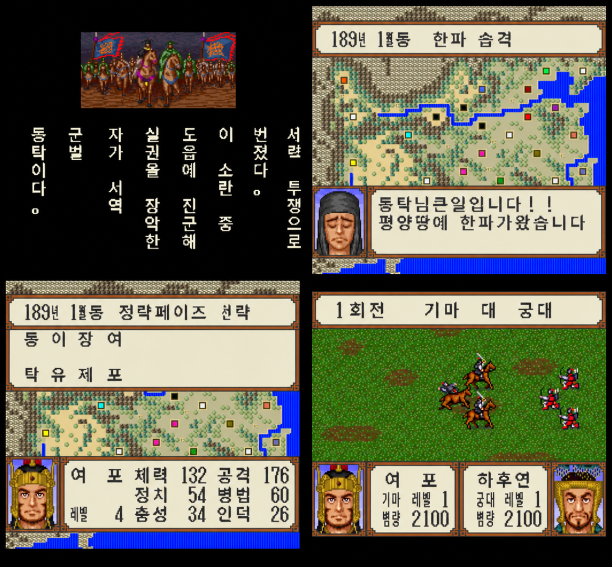

# 横山光輝 三國志 (SFC, 1992) 한글 패치 v0.8 (베타)

슈퍼패미컴 「요코야마 미츠테루 삼국지」(엔젤, 1992) 1편 한글 패치입니다. (비영리 팬 번역)

## 필요한 롬
- **Yokoyama Mitsuteru Sangokushi (Japan) (Rev 1)**, 1,048,576바이트
- SHA-256 `414702673ddbeffd61e2919b05e7cdbfb6fc90920f386c328ac8beedafeeac30`
- 무표기판(Rev 0)에는 적용되지 않습니다. 롬은 직접 구하셔야 하며 이 저장소에는 게임 데이터가 없습니다.

## 적용 방법
1. **웹 페이지**: <https://komandoo9898.github.io/yokoyama-sangokushi-sfc-ko-patch/> (보통) / [bold.html](https://komandoo9898.github.io/yokoyama-sangokushi-sfc-ko-patch/bold.html) (굵게) — 롬을 끌어다 놓으면 브라우저 안에서만 패치합니다(서버 전송 없음).
2. **IPS 직접 적용**: `Sangokushi_ko_reg.ips`(보통) 또는 `Sangokushi_ko_bold.ips`(굵게)를 Rev 1 롬에 Lunar IPS 등으로 적용.

| 파일 | 결과 롬 SHA-256 |
|---|---|
| Sangokushi_ko_reg.ips | `f4e8f37bd4b1ab4d40357694b08f44b026da8de420e0042f0032407cb6db36cf` |
| Sangokushi_ko_bold.ips | `3142ecc7aa68f6e91fadb4958beb1309e4c734ce0e7913f5a0aa825ec2e64ab0` |

## 내용
- 대사 340개, 시나리오 해설, 메뉴·라벨, 인명 224·지명 31 전량 한글화(합쇼체).
- 한자로 남는 글자는 한자 독음 한글 도안으로 교체(정보창의 한 글자 항목 라벨은 한자 유지).
- 롬 용량 변경 없음(1MB 그대로, 원본 자리에 재배치).

## 알려진 문제 (베타)
- 날짜 헤더의 月/계절 글자 크기 배치가 어색합니다(수정 예정).
- 일부 숨은 문자열·한자가 남아 있을 수 있습니다. 화면 제보를 환영합니다.
- 번역 2차 검수 중입니다.

## 크레딧·라이선스
- 한글화: KNH
- 글꼴: Noto Sans KR (SIL Open Font License 1.1, `OFL.txt`)로 도안 제작
- 패치(IPS)에는 원본 게임 데이터가 포함되어 있지 않으며, 원작 권리는 각 권리자에게 있습니다.
